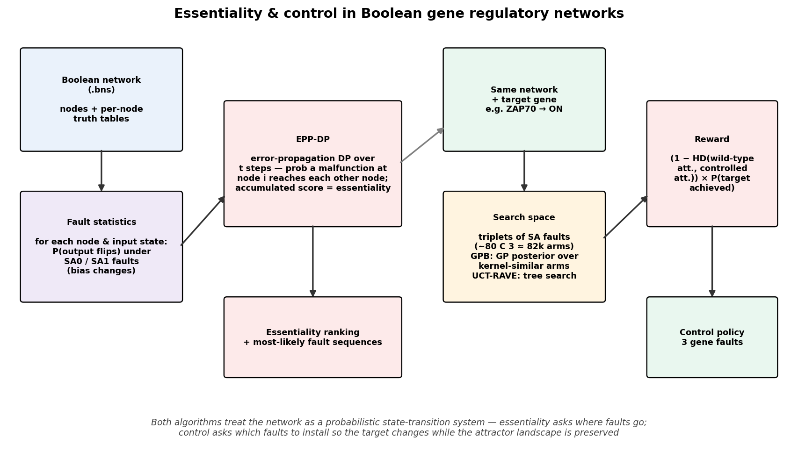
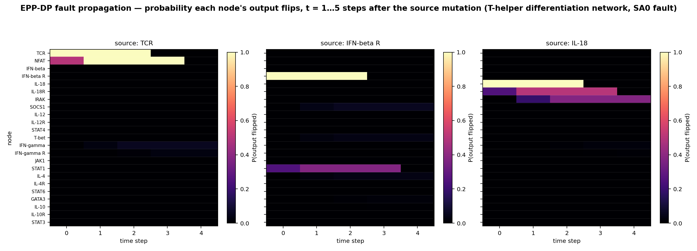
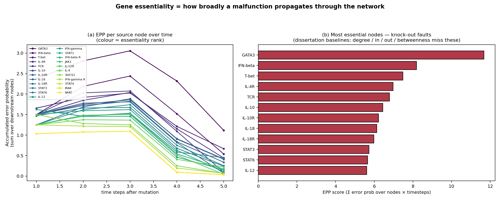
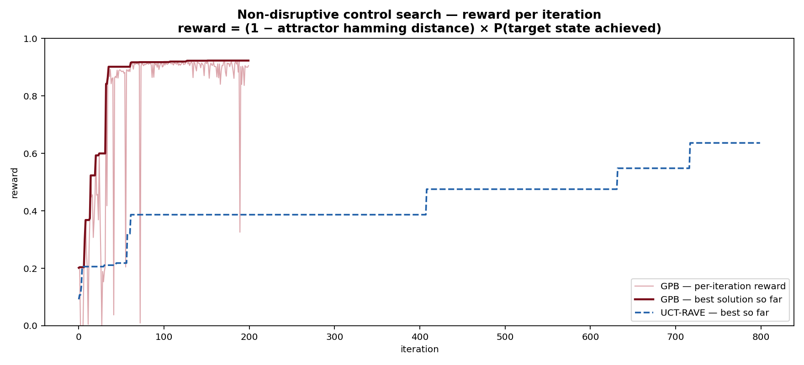
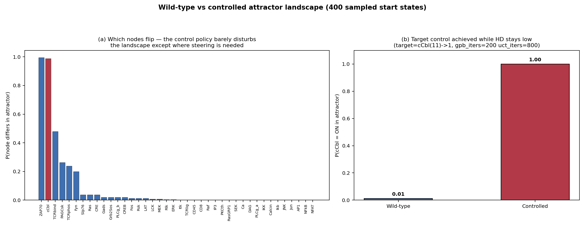

# Essentiality & Control in Gene Regulatory Networks

> Which genes, when broken, break the cell? And which *other* genes can we
> perturb to steer a target gene — without rewiring the rest of the network?
> Two algorithms on Boolean network models of real signalling pathways.

[](dissertation/RudiAgius_MSc_ML_Dissertation.pdf)
[]()
[]()

**Rudi Agius** — UCL MSc Machine Learning dissertation work · 2009

---

## Two problems, one framework

Both algorithms treat a gene regulatory network as a **probabilistic
state-transition system** and ask complementary questions:

| | **Essentiality** (EPP-DP) | **Control** (GPB / UCT) |
|---|---|---|
| Question | If gene *i* malfunctions (knock-out / over-expression), how far does the damage spread? | Which *triplet* of gene perturbations steers a **target** gene to a desired state while leaving the network's attractor landscape intact? |
| Method | Dynamic Programming over error-propagation probabilities | Gaussian Process Bandits + UCT / UCT-RAVE tree search |
| Output | Per-node essentiality ranking + most-likely fault sequences | A control policy (3 stuck-at faults) + its reward |
| Novelty | Uses *dynamic* network information (Boolean function + bias), not just topology — catches essential genes that degree/betweenness miss | "Non-disruptive control": the reward couples target achievement to attractor preservation |



## 1. Essentiality via error propagation (EPP-DP)

**Idea** (`code/essentiality/`): a node is essential to the extent that a
malfunction *originating at that node* propagates through the network and
corrupts other nodes' outputs. For every node, local Boolean-function
information is extracted — its **bias** (fraction of input states producing
output 1), how the bias **changes** when each input is stuck at 0/1, and the
**propagating state spaces** (the input states through which a fault on an
input would flip the output).

A stuck-at-0 (SA0) or stuck-at-1 (SA1) fault is placed at source node *s* and
propagated by DP for *t* steps. At each step the algorithm maintains, for every
node, the probability that its output has flipped — and the **most likely
sequence** of propagations (Viterbi-style traceback, free by-product of the
DP). The accumulated per-time-step error probabilities produce the ranking:

$$
\mathrm{EPP}(s) \;=\; \sum_{t=1}^{T} \sum_{j} P_j\!\left(\text{output flipped at } t \mid s^{SA}\right)
$$

with complexity $O(2^k n t)$ — $k$ = max in-degree — versus $O(n^2 t)$ for the
standard DP treatment. Separate SA0/SA1 rankings are produced (a node can be
essential in one regime and irrelevant in the other).

Three subtleties the method captures that centrality measures cannot:

* **Bias effects** — input-node biases weight the propagating state spaces;
  equally-structured nodes propagate differently.
* **Self-blocking** — a source fault can shrink its own propagating state
  space (re-convergent paths); the DP handles this explicitly.
* **Fault direction** — knock-out vs over-expression are ranked separately.

### Reproduced — T-helper differentiation network (23 genes)

`octave-cli examples/run_essentiality.m` runs the **original** `DPALGONEW.m`
engine on the bundled T-helper network and dumps every per-node propagation
matrix:



*Each panel: the probability every other node's output flips within t = 1…5
steps of the source mutation. Propagation through the real network is sparse
and channelled — not a diffusion blur — which is exactly why static centrality
misses it.*



*Left: accumulated error probability per source over time (colour = rank).
Right: the top-12 most essential nodes under SA0. The dissertation shows EPP
detects genes that degree / in-degree / out-degree / betweenness all rank low
— e.g. IFN-βR here, CD45 and Raf/Grb2Sos in the T-cell receptor network, en3
in the Drosophila segment-polarity network, UFO→AP3 in Arabidopsis.*

**Dissertation findings** — across four biological networks (T-helper
differentiation, T-cell receptor signalling, Arabidopsis flower morphogenesis,
Drosophila segment polarity), EPP-DP uniquely detected known essential genes
that all four static baselines ranked near the bottom (§8.1).

## 2. Non-disruptive control (GPB / UCT-RAVE)

**Idea** (`code/control-gpb/`, `code/control-uct/`): installing a permanent
stuck-at fault on a gene is trivially easy — clamp it to 0 or 1. The hard part
is doing it *without* collapsing the network's wild-type behaviour. The
dissertation's answer is a reward that prices both goals:

$$
R = \underbrace{\bigl(1 - \overline{d_H}\bigr)}_{\text{attractor preservation}}
\;\times\;
\underbrace{\overline{\mathbb{1}[x_{\text{target}} = v_{\text{target}}]}}_{\text{control achieved}}
$$

where each evaluation rolls out `RewardRuns` random start states to their
attractors — once on the wild-type network, once on the faulted network —
and $\overline{d_H}$ is the mean normalised Hamming distance between the two
attractor landscapes. A perfect score of 1.0 means: the target is achieved in
*every* sampled attractor *and nothing else changed*.

The search space is triplets of SA faults over 80 candidate actions (40 genes
× 2 directions) — $\binom{80}{3} \approx 82{,}160$ arms — far too large for
exhaustion, so two learners compete:

* **GPB — Gaussian Process Bandits** (`GPClusterSearch.m`): a GP over arm
  rewards with a **pairwise kernel that scores similarity between
  fault-triplet *sets*** (clusters of related arms explored hierarchically).
  Posterior mean + uncertainty → upper-confidence arm selection:
  $a_t = \arg\max_a\; \mu_t(a) + \beta\,\sigma_t(a)$.
* **UCT / UCT-RAVE** (`UCTAlgoP.m`, `UCTAlgoC.m`): tree search over ordered
  move sequences (P-tree) or sets (C-tree). UCB1 selection
  $\arg\max_a \bar{X}_{s,a} + c\sqrt{2\ln N_s / N_{s,a}}$ ($c = 0.15$),
  domain-dependent simulation (50% primary inputs of the target, 50% random
  moves), and RAVE updates that generalise move values to ancestor states —
  blended with the UCT estimate, $\beta = \sqrt{k/(3n+k)}$.

> ⚠️ `code/control-uct/ApplyExploitF.m` is a **documented reconstruction** —
> the original file was never archived (it lived on the author's MATLAB path,
> not in the project folder). It implements exactly the dissertation's
> §3.1.3 UCB1 selection + §6.5.2.1 RAVE blend.

### Reproduced — T-cell receptor signalling network (40 genes)

`octave-cli examples/run_control.m 11` runs the **original** `GPClusterSearch`
on the bundled `TCellNetworkData.mat` for target **cCbl → ON**:



*GPB climbs from ~0.2 to ~0.91 within ~40 iterations and stays there — the
dissertation's final value for this target was 0.9154 (449 iterations). The
search finds a fault triplet that achieves the target in **100%** of sampled
attractors while changing **only ~8.5%** of the landscape's state bits.*



*Left: the nodes whose attractor values actually move under the policy —
concentrated on the faulted genes and the target's local neighbourhood, not a
global scramble. Right: target-gene occupancy jumps 0.01 → 1.00.*

### Dissertation results (T-cell receptor network, 5-run averages)

Reward = preservation × target achievement; **bold** = best per target.

| Target | Direct control | Primary-input control | UCT (C-tree) | UCT-RAVE (C) | UCT-RAVE (P) | **GPB** |
|---|---|---|---|---|---|---|
| LCK    | 0.796 | 0.665 | 0.659 | 0.659 | 0.659 | 0.485 |
| ZAP70  | 0.203 | 0.182 | 0.530 | 0.547 | 0.581 | **0.599** |
| cCbl   | 0.935 | 0.202 | 0.817 | 0.913 | 0.911 | **0.915** |
| Itk    | 0.975 | 0.201 | 0.602 | 0.603 | 0.818 | **0.868** |
| LAT    | 0.668 | 0.202 | 0.599 | 0.865 | 0.862 | 0.864 |
| DAG    | 0.542 | 0.418 | 0.633 | 0.845 | **0.946** | 0.670 |
| PLCg_a | 0.417 | 0.205 | 0.452 | 0.452 | **0.668** | 0.571 |
| RasGRP1| 0.768 | 0.544 | 0.596 | 0.686 | **0.832** | 0.633 |

GPB (449 iterations, 40 reward runs/eval) **beats or matches the tree search
on 4 of 8 targets and decisively beats both naive baselines on all**;
UCT-RAVE on the permutation tree wins the remainder. Dissertation parameters:
UCT-RAVE 1500 iters, 10 sims/iter, C = 0.15, RAVE-blend + domain-dependent
simulation.

## Run it yourself

Requires GNU Octave ≥ 9 (or MATLAB). From the repository root:

```bash
# Essentiality — T-helper differentiation network (23 nodes, ~30 s)
octave-cli examples/run_essentiality.m

# Control — T-cell receptor network
octave-cli examples/run_control.m [target] [gpb_iters] [uct_iters]
#   target     node index (default 10 = ZAP70; dissertation set:
#              LCK=6 ZAP70=10 cCbl=11 Itk=12 LAT=13 DAG=18 PLCg_a=19 RasGRP1=21)
#   gpb_iters  default 120   (dissertation used 449)
#   uct_iters  default 300   (dissertation used 1500)

# Figures (Python + matplotlib) from the generated CSVs
python examples/make_figures.py
```

All raw output lands in `results/generated/` (per-node propagation matrices,
reward curves, attractor pairs, rankings); figures land in `docs/figures/`.

## Repository layout

| Path | Contents |
|---|---|
| `code/essentiality/` | EPP-DP: `EPP_DP.m` driver, `DPALGONEW.m` (DP engine), `EPPMatrices.m`, `ErrorProp.m`, `readingtext.m`, T-helper network (`thelper.txt`, `THelp*.mat`) |
| `code/control-gpb/` | GPB: `GPClusterSearch.m`, `GPReward.m` (GP posterior), `PairWiseKernel.m` / `KernelCalc.m` / `SelfKernel.m` (fault-triplet kernel), `HClustering.m`, `ApplySAFaults.m` (reward evaluator), `FindAtt.m`, T-cell data (`TCellNetworkData.mat`, `TCellTree.mat`, `Tcell.txt`) |
| `code/control-uct/` | UCT/UCT-RAVE: `UCTAlgoP.m` / `UCTAlgoC.m`, `ApplyMove{P,F}.m`, `RAVE.m`, `SimulateGame{P,F}.m`, `ApplyUCTSAFaults.m`, `TNodeHeuristic.m` (domain simulation) — + `ApplyExploitF.m` (reconstruction, see note above) |
| `dissertation/` | The full dissertation + abstract (theory, derivation, all results) |
| `results/Control Results.xls` | The original results tables |
| `examples/` | NEW Octave drivers + Python figure scripts (original code untouched) |
| `results/generated/` | Fresh outputs produced by the drivers |
| `docs/figures/` | Generated showcase figures |

## What's novel here

* **Dynamic, information-aware essentiality** — the first centrality measure
  (at the time, 2009) to exploit *what actually flows through the edges* —
  Boolean function output biases and propagating state spaces — rather than
  just who-is-connected-to-whom. It detects essential genes invisible to all
  static baselines, and separates knock-out from over-expression essentiality.
* **Non-disruptive control objective** — attractor-preservation ×
  target-achievement as a single reward, evaluated by probabilistic attractor
  rollouts. Control policies that steer *and* preserve.
* **Kernelised GP bandits over combinatorial arms** — a pairwise kernel on
  fault-triplet sets lets the GP share evidence across 82k related arms;
  converges in ~40 iterations where UCT needs ~1000.
* **Biological grounding** — everything runs on published network models
  (Klamt's T-helper net; the T-cell receptor signalling net), not toys.

## Source material

* Dissertation: [`dissertation/RudiAgius_MSc_ML_Dissertation.pdf`](dissertation/RudiAgius_MSc_ML_Dissertation.pdf)
  — full derivations (Ch. 3 bandits/GPs, Ch. 5–6 methods, Ch. 7–8 results).
* Abstract: [`dissertation/RudiAgius_MSc_ML_Abstract.pdf`](dissertation/RudiAgius_MSc_ML_Abstract.pdf).
* EPP-DP conference abstract (UK SP, 2010): `results/EPP-DP_Abstract_2010_UK_SP_Conference.docx`.
* The network definitions come from the public Dubrova `.bns` collection.

## Notes

* `code/essentiality/ErrorProp.m` carries four one-line Octave-compat fixes
  (marked in-place): `strread` returns a column, which old MATLAB tolerated in
  `.*` but Octave broadcasts — the maths is unchanged.
* `results/generated/` contains fresh output — regenerate at will; nothing
  there is source of truth.
