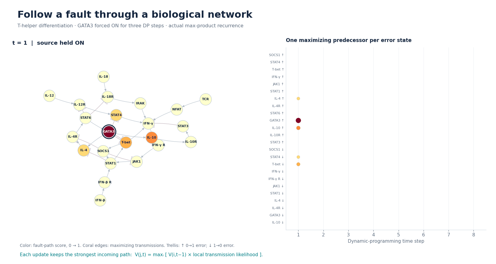
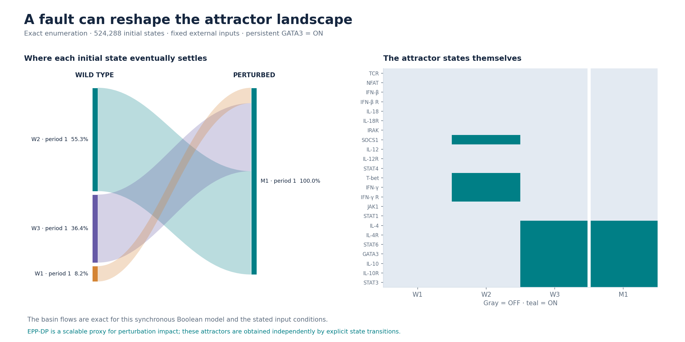
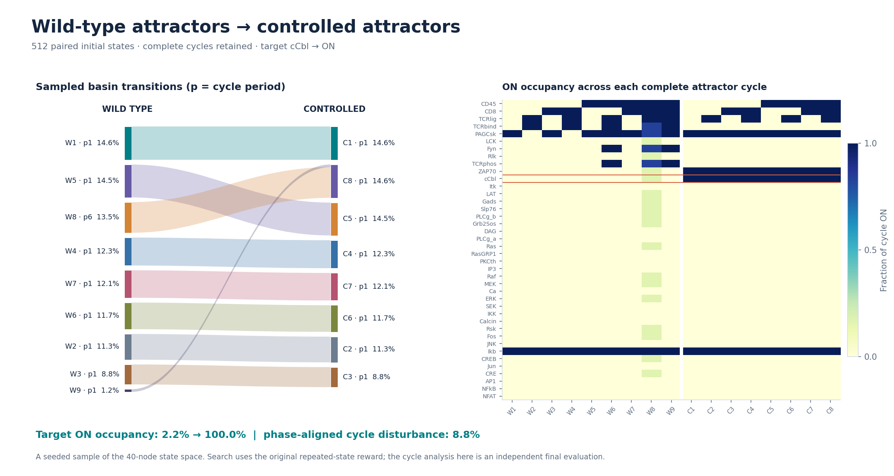

# Essentiality & Control in Gene Regulatory Networks

**What makes a gene important to a network, and how can we change one part of that network while disturbing the rest as little as possible?**

We approach these questions through Boolean models of biological regulation. For essentiality, we borrow an idea from fault diagnosis in digital circuits: force a component OFF or ON, then follow the errors it can transmit. For control, we search for combinations of interventions that steer a target gene while rewarding preservation of wild-type behavior.

The connection is the network's dynamics: **what the components do, how a perturbation travels, and where the system eventually settles.**



*An actual EPP-DP run on the 23-node T-helper differentiation network. GATA3 is the source of a three-step ON fault; the animation follows eight DP steps. Node colors and highlighted transmissions come from the computed scores and maximizing predecessors. These are fault-path scores, not measured gene expression.*

## From circuit faults to an essentiality proxy

A highly connected gene need not transmit a large disturbance. Its Boolean function may block an incoming error; a less connected gene may sit on a sensitive regulatory route. EPP-DP combines connectivity with the logic at each node, input-state biases and the direction of the malfunction.

| Circuit concept | Boolean biological model | What we calculate |
|---|---|---|
| Stuck-at-0 (SA0) | A gene or signaling component held OFF | Knockout-like fault influence |
| Stuck-at-1 (SA1) | A component held ON | Constitutive-activation-like fault influence |
| Fault propagation | An input error changes a downstream output | Directional transmission likelihoods |
| Dynamic programming | Retain the strongest incoming fault path at each step | Time-dependent influence, rankings and tracebacks |

We use the spread of a fault as a **proxy for essentiality within the model**. It describes sensitivity to a specified perturbation; biological essentiality also depends on the phenotype, context and experimental evidence.

To see what such a perturbation can do to long-term behavior, we can also run the Boolean network itself:



*All 524,288 admissible initial states are enumerated, with TCR, IFN-beta, IL-18 and IL-12 held OFF. The wild type has three fixed-point attractors. Holding GATA3 ON permanently brings every start to one fixed point. Ribbon widths count paired initial states; the adjacent matrix shows the attractor states themselves. This persistent perturbation is a separate experiment from the three-step DP pulse above.*

[See SA0/SA1 rankings and the complete DP trellis](docs/FIGURES.md#essentiality) | [Read the method](docs/METHODS.md#essentiality-through-error-propagation)

## Control a target, account for the consequences

For control, the target may be unavailable for direct intervention. We therefore search over **three distinct, non-target genes**, each held OFF or ON. A useful intervention must do two things: achieve the target state and limit changes elsewhere in the network.

We implement two search strategies: **Gaussian Process Bandits (GPB)**, which share information between related intervention sets, and **UCT / UCT-RAVE**, which build a search tree and evaluate candidate policies through simulation.


*The 40-node T-cell receptor signaling model, with cCbl as the indirect-control target. Both panels follow the actual synchronous truth tables. Gold means ON; coral outlines identify interventions; the teal outline identifies cCbl. The selected trajectory illustrates a transition; the population-level evaluation is below.*



*We evaluate the selected GPB policy on 512 fresh paired initial states and retain every state of each periodic attractor. The ribbons show sampled basin transitions, and the matrix shows the fraction of each attractor cycle spent ON. The reported target occupancy and cycle disturbance describe this evaluation sample. They do not imply that all wild-type attractors are preserved.*

In the supplied seeded run, GPB selects **ZAP70 ON, Fyn OFF and LAT OFF**. On the independent evaluation sample, cCbl's ON occupancy rises from **2.2% to 100%**, with **8.8% mean phase-aligned cycle disturbance** across all 40 nodes.

[Inspect the search curves](docs/FIGURES.md#control) | [Understand the reward and cycle comparison](docs/METHODS.md#control-and-attractor-preservation)

## Run the examples

Install **Python 3.10+** and **GNU Octave**, then run these commands from the repository root:

```bash
python -m pip install -r requirements.txt
python examples/build_showcase.py
```

This runs the native essentiality and control algorithms, enumerates the T-helper basins, evaluates the control policy and rebuilds the figures. The supplied example uses 200 GPB iterations and 180 UCT-RAVE iterations with fixed random seeds.

To explore the figures immediately using the bundled algorithm outputs, Python alone is sufficient:

```bash
python examples/build_showcase.py --figures-only
```

[Installation, MATLAB entry points, parameters and output formats](docs/USAGE.md)

## Explore the implementation

| Start here | Purpose |
|---|---|
| [Essentiality](code/essentiality/README.md) | Parse the model, extract fault statistics, run max-product DP and rank source faults |
| [GPB control](code/control-gpb/README.md) | Search intervention sets with a structured kernel and hierarchical arm expansion |
| [UCT control](code/control-uct/README.md) | Explore permutation or combination trees, simulate policies and update UCT/RAVE values |
| [Dynamics and figures](grnlab/README.md) | Evaluate truth tables, retain complete cycles, enumerate basins and draw the results |
| [Code guide](docs/CODE_GUIDE.md) | Follow the data through the implementation and identify the role of each component |

The native research algorithms are MATLAB/Octave code. The essentiality engine uses the modular GSK-toolbox formulation, with a compact local-likelihood helper; Python adds exact state-space analysis and visualization. The [methods](docs/METHODS.md) explain the score interpretation and implementation boundaries.

## Research and biological models

**Rudi Agius - Essentiality and Control in Gene Regulatory Networks (2009).** We developed this work at UCL, supervised by John Shawe-Taylor and Steven J. Barrett. The research covers essentiality in T-helper differentiation, T-cell receptor signaling, Arabidopsis flower morphogenesis and Drosophila segment polarity, and control in the T-cell receptor model. The runnable examples here contain the two T-cell models.

- [Essentiality and Control in Gene Regulatory Networks](docs/research/essentiality-and-control-in-gene-regulatory-networks.pdf) - full research report, derivations and original experiments.
- [Research summary](docs/research/essentiality-and-control-summary.pdf).
- [Dynamic Programming-based Error-Propagation Probability for Gene Essentiality](docs/research/dynamic-programming-error-propagation-gene-essentiality.pptx) - research poster by Rudi Agius and Steven J. Barrett.
- [Original control-search results](docs/research/control-search-results.xls).

[Model provenance, research context and references](docs/RESEARCH.md)
