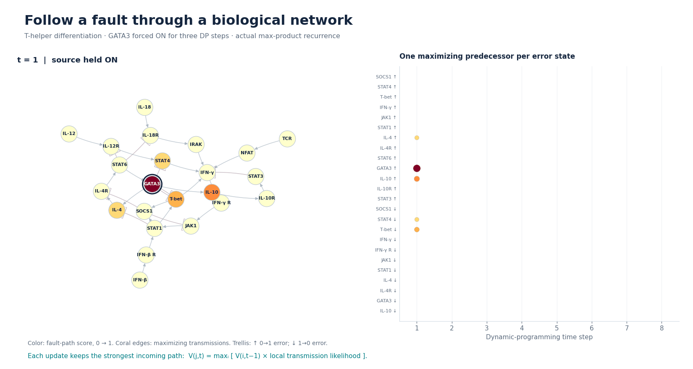
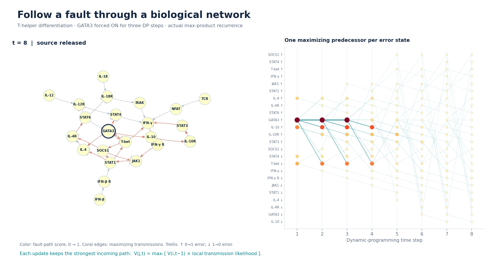
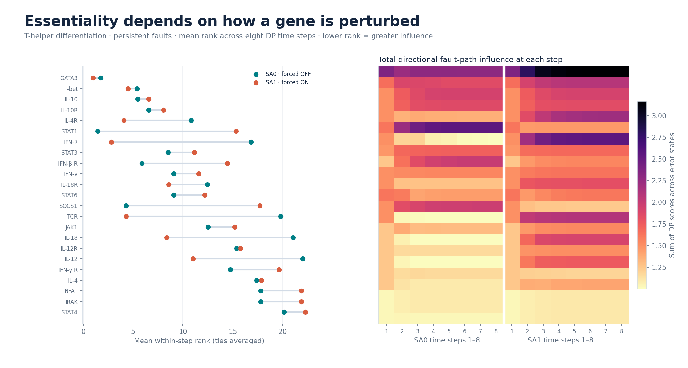
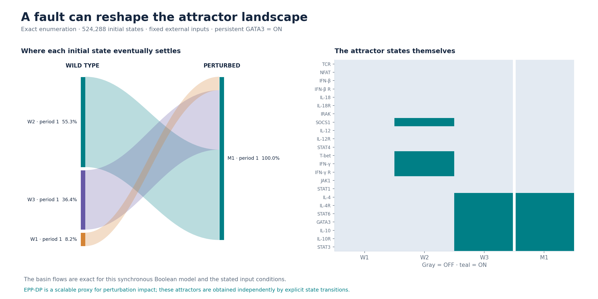
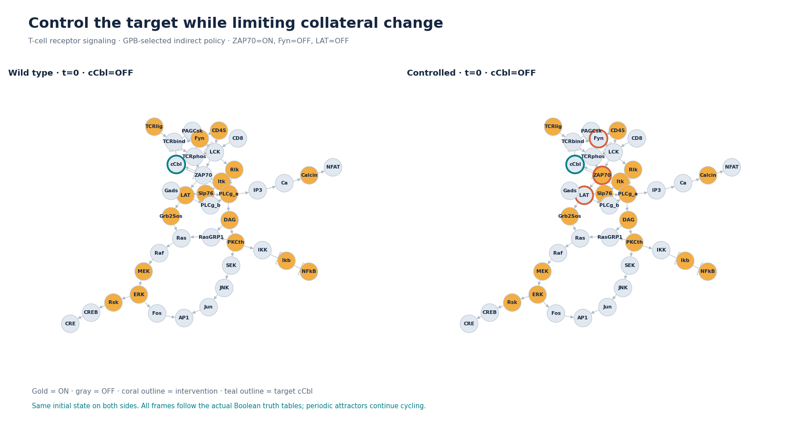
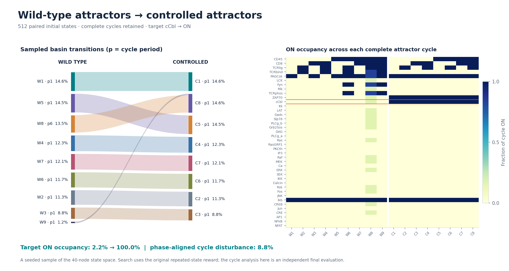
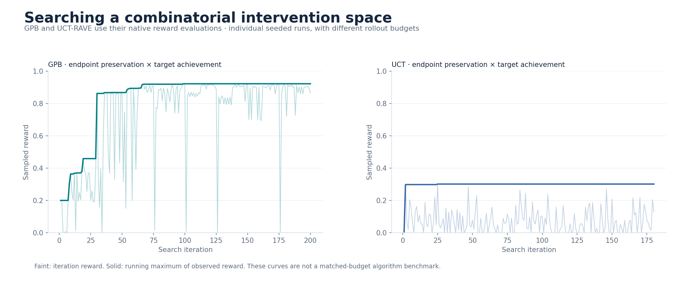

# Figures: follow the calculations

[Overview](../README.md) | [Run the examples](USAGE.md) | [Methods](METHODS.md)

Every panel is generated from the native algorithm outputs or explicit transitions of the exported Boolean truth tables. The figures use separate visual encodings for **fault-path scores**, **binary states** and **cycle occupancy**.

## Essentiality

### Fault propagation and DP paths

The source is held for three DP columns and released; eight columns are calculated. Warm node colors show the strongest of the two directional scores at that node. Coral network edges show maximizing predecessor transmissions for the current column. In the trellis, up/down arrows label 0-to-1 and 1-to-0 errors. Dot area and color encode the score. The trellis displays the active channels (up to the 24 with largest cumulative influence if necessary). Network self-loops are omitted for legibility; they remain in all calculations. Arrowheads indicate activation, bars inhibition, and purple edges context-dependent effects inferred from the truth tables; highlighted DP transmissions use arrowheads to show error travel rather than regulatory sign.

A predecessor is the maximizing route at one step, not a statement that other routes cannot transmit an error. The sum of path scores is an influence measure, not a marginal probability. [Details](METHODS.md#essentiality-through-error-propagation).

### SA0 and SA1 can give different rankings

Persistent faults are used for all eight columns. The left panel shows mean per-step rank with ties averaged; the right panel shows each source's summed directional scores at each step. For display, rows are ordered by the average of their SA0 and SA1 mean ranks; each fault direction retains its own scores. The plot distinguishes forced-OFF and forced-ON sensitivity rather than averaging away their differences.

### From a fault to a changed landscape

The wild-type and persistent GATA3-ON models are evaluated over the same 524,288 starts, with four fixed external inputs. Ribbon widths are exact counts for this model and condition. The matrix shows every node in every fixed point. [Scalable SVG](figures/attractor_landscape.svg).

## Control

### Watch an intervention take effect

Both trajectories start from the same sampled state before the policy clamps are applied. The controlled initial state already reflects those clamps. Gold is ON and gray is OFF; coral outlines mark intervention genes and teal marks cCbl. Periodic attractors continue cycling in the animation. The displayed start is chosen by a documented rule to illustrate target improvement; the whole evaluation sample is summarized below.

### Compare final attractors, including cycles

Each ribbon counts paired starts in the independent sample of 512. Labels include the attractor period. The matrix records ON occupancy over the complete cycle, so a periodic attractor is not silently reduced to one state. Disturbance compares full cycles after relative phase alignment. This is a sample of the 40-node state space, not exhaustive basin enumeration. [Scalable SVG](figures/control_attractors.svg).

### Inspect how search progresses

Faint curves are native iteration rewards; solid curves are their running maxima. GPB uses one sampled policy reward per iteration; UCT uses the mean of its rollouts. A recommendation's own best rollout reward is stored separately from the mean used for tree updates. The budgets differ, so these curves illustrate search behavior rather than establish a performance ranking.

## Reproduction

Run `python examples/build_showcase.py` to calculate native outputs and rebuild all panels, or add `--figures-only` to use the bundled outputs. Seeds, named interventions, basin sizes and evaluation metrics are recorded in [analysis.json](../results/demo/analysis.json). Figure construction is in [figures.py](../grnlab/figures.py).
