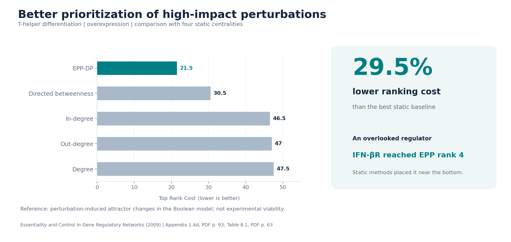
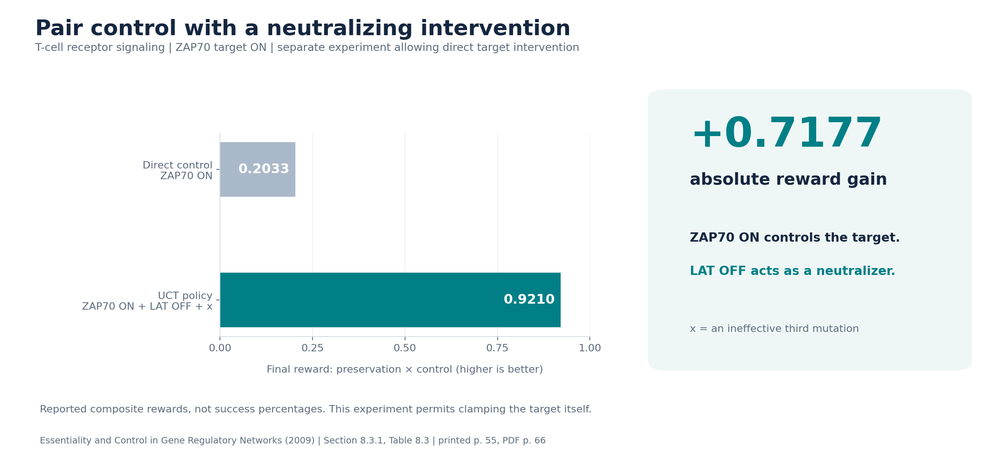

# Key results from the original research

[Overview](../README.md) | [Methods](METHODS.md) | [Research materials](RESEARCH.md)

The two results below come from **Essentiality and Control in Gene Regulatory Networks**, Rudi Agius (2009). The figures redraw the reported table values. Derived improvements are calculated from those values; these experiments are separate from the current seeded examples.

## Essentiality: prioritizing high-impact perturbations



In the 23-node T-helper differentiation model, under the overexpression (SA1) scenario, **EPP-DP achieved the lowest Top Rank Cost among the five methods compared**:

| Method | Top Rank Cost (lower is better) |
|---|---:|
| EPP-DP | **21.5** |
| Directed betweenness | 30.5 |
| In-degree | 46.5 |
| Out-degree | 47.0 |
| Degree | 47.5 |

The improvement relative to the best static comparator is `(30.5 - 21.5) / 30.5 = 29.5%` lower cost. It is a reduction in a ranking penalty, not a 29.5-point increase in prediction accuracy.

The reference rankings were obtained by finding wild-type and perturbed attractors with a SAT-based solver. The research treats an attractor as preserved when 90% of its original gene values are preserved, then groups perturbations according to their effects on attractor preservation. The Top Rank Cost focuses on the positions assigned to the high-impact reference set, with tied ranks averaged. This particular table uses the worst-effect set. It evaluates essentiality as a Boolean-model perturbation proxy, not experimental viability.

A named example helps explain the advantage: **IFN-beta R reaches EPP rank 4**, while the static methods place it near the bottom of their displayed lists. This illustrates the value of using regulatory logic as well as connectivity.

Sources: Appendix 1.4d ([PDF p. 93](research/essentiality-and-control-in-gene-regulatory-networks.pdf#page=93)); metric and reference definitions in Sections 7.2.1-7.2.3 ([PDF pp. 55-56](research/essentiality-and-control-in-gene-regulatory-networks.pdf#page=55)); IFN-beta R example in Section 8.1.2.1 and Table 8.1 ([PDF pp. 62-63](research/essentiality-and-control-in-gene-regulatory-networks.pdf#page=63)).

[Source values](../results/thesis/essentiality_thelper_overexpression.csv) | [Scalable figure](figures/thesis_essentiality_result.svg)

## Control: pairing control with neutralization



In the T-cell receptor signaling model, we explicitly allowed UCT to include the target gene in its intervention set to examine the role of **neutralizing mutations**. For target ZAP70 ON:

| Strategy | Reported final reward (higher is better) |
|---|---:|
| Direct control: ZAP70 ON | 0.2033 |
| UCT policy: ZAP70 ON, LAT OFF, x | **0.9210** |

The absolute reward gain is `0.9210 - 0.2033 = 0.7177`. Here `x` denotes an ineffective third mutation; the source describes solutions varying over such mutations rather than identifying one fixed third gene.

The final reward combines target achievement with preservation of wild-type attractor representatives. Direct ZAP70 activation controls the target but strongly disturbs the rest of the model. The research identifies LAT OFF as a neutralizing mutation that subdues this disturbance while the target stays ON.

This is a **target-enabled intervention experiment**. It demonstrates the benefit of a neutralizing intervention over clamping the target alone. It is distinct from the repository's cCbl example, which excludes the target from intervention, and does not establish a matched-budget ranking of GPB and UCT. The values are reported composite rewards, not success percentages; no uncertainty estimates or repeated-run aggregation are specified for this separate experiment.

Source: Section 8.3.1 and Table 8.3, printed p. 55 ([PDF p. 66](research/essentiality-and-control-in-gene-regulatory-networks.pdf#page=66)).

[Source values](../results/thesis/control_zap70_neutralization.csv) | [Scalable figure](figures/thesis_control_result.svg)

## Rebuild these figures

```bash
python examples/build_thesis_figures.py
```

The full showcase command also rebuilds them. [provenance.json](../results/thesis/provenance.json) records source pages, definitions and experimental scope. Plotting code is in [thesis.py](../grnlab/thesis.py).
